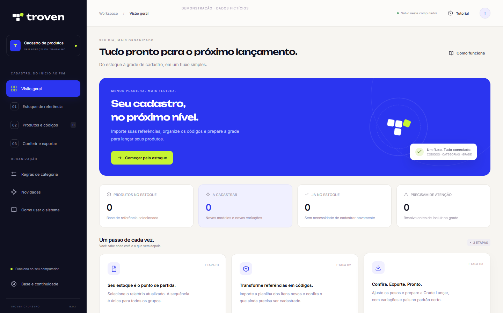

<p align="center">
  <a href="https://marca.troven.com.br/">
    <picture>
      <source media="(prefers-color-scheme: dark)" srcset="docs/marca/troven-horizontal-negativo.svg">
      
    </picture>
  </a>
</p>

<h1 align="center">Troven Cadastro</h1>

<p align="center"><strong>Seu cadastro, mais fluido.</strong><br>Do Excel de estoque à grade de produtos, com códigos, categorias e pesos organizados.</p>

<p align="center"><strong>Um produto Troven.</strong><br>Feito para simplificar o trabalho entre a planilha e o ERP.</p>

<p align="center">
  <a href="https://github.com/TrovenDev/greta-criar-codigos-releases/releases/latest"></a>
  <a href="https://github.com/TrovenDev/greta-criar-codigos-releases/releases/download/v9.0.1/Troven-Cadastro-Demonstracao.mp4"></a>
</p>

<p align="center">
  <a href="https://github.com/TrovenDev/greta-criar-codigos-releases/releases/latest"></a>
  
  
</p>



## Da planilha ao próximo cadastro

| 01 · Importe | 02 · Organize | 03 · Exporte |
| :--- | :--- | :--- |
| Abra o estoque e as referências novas. Escolha as colunas que fazem parte do seu cadastro. | Confira categorias, tamanhos, cores e pesos. O sistema ajuda a distinguir modelos e variações. | Revise a grade e gere o Excel no formato do ERP. |

## O que o Troven Cadastro faz por você

- **Códigos organizados.** Sequência geral entre categorias, com variações que compartilham o número do modelo.
- **Tamanho certo.** Sem tamanho informado, usa `J` e preserva a cor.
- **Peso por unidade.** Divide o peso total pela quantidade e mostra a conta na prévia. Moissanite e flower sem peso unitário usam PC/PR.
- **Categorias em lote.** Aplique um GP a vários produtos e salve regras para as próximas importações.
- **Grade pronta para conferir.** Formatos de exportação editáveis, com controle dos itens que entram no arquivo.
- **Continuidade.** Reservas, regras e lote salvos fora da instalação para continuar depois.

## Baixe e comece

| Seu computador | Instalador 9.2.1 |
| :--- | :--- |
| **Windows 10 / 11 x64** | [Baixar instalador](https://github.com/TrovenDev/greta-criar-codigos-releases/releases/download/v9.2.1/Troven-Cadastro-Instalador-v9.2.1.exe) |
| **Windows 7 SP1 x64** | [Baixar edição Win7](https://github.com/TrovenDev/greta-criar-codigos-releases/releases/download/v9.2.1/Troven-Cadastro-Instalador-v9.2.1-Win7-x64.exe) |

1. Baixe o instalador correspondente ao seu Windows e siga o assistente.
2. Abra **Troven Cadastro** no menu Iniciar.
3. Comece pelo estoque. O tutorial dentro do aplicativo também abre com **F1**.

Não é necessário instalar Python ou Microsoft Excel. No Windows 10/11, o instalador
prepara o WebView2 pela internet quando necessário. Na edição **Windows 7 SP1 x64**,
instale antes **.NET Framework 4.8** e **Microsoft WebView2 Runtime 109 x64**.
A execução dessa edição ainda precisa ser validada em uma máquina com Windows 7.

[Todas as versões e notas de atualização](https://github.com/TrovenDev/greta-criar-codigos-releases/releases) ·
[Conferir SHA-256 da 9.2.1](https://github.com/TrovenDev/greta-criar-codigos-releases/releases/download/v9.2.1/SHA256SUMS.txt)

## Seu trabalho continua salvo

Reservas, regras e o último lote ficam nesta pasta:

```text
%LOCALAPPDATA%\Troven\Cadastro
```

O instalador preserva esses dados. Faça backup com o aplicativo fechado.
O processamento das planilhas é local; a importação da grade no ERP é feita por você.

O aplicativo consulta este repositório público para encontrar atualizações.
Instalações anteriores à 9.2.0 precisam receber o novo instalador manualmente uma vez
para passar a usar este endereço. O código-fonte fica em um repositório privado.

---

<p align="center">
  <a href="https://marca.troven.com.br/">
    <picture>
      <source media="(prefers-color-scheme: dark)" srcset="docs/marca/troven-horizontal-negativo.svg">
      
    </picture>
  </a>
</p>

<p align="center">
  <strong>Troven Cadastro é um produto Troven.</strong><br>
  Menos trabalho repetitivo. Mais clareza para o próximo lançamento.<br><br>
  <a href="https://www.troven.com.br/">Conheça a Troven</a> ·
  <a href="https://marca.troven.com.br/">Identidade oficial</a>
</p>
